# Code and data flow

This diagram follows `src/ensemble_sensitivity/main.py` into the implemented
retrieval and quicklook commands. Function nodes are rectangles; round nodes are
inputs, outputs, or persisted artifacts. Nested groups show the major pipeline
stages. Gray nodes are shared infrastructure rather than PEARP-specific steps.

```mermaid
flowchart TB
    subgraph entry["Entry point — src/ensemble_sensitivity/main.py"]
        argv((CLI arguments)) --> parse["parse_args()"]
        parse --> configure["configure_logging()"]
        configure --> dispatch{"main(): selected command"}
        fetch_options((fetch options:<br/>target lead, step, output dir,<br/>env file, optional coverage ID))
        plot_options((plot options:<br/>run directory, leads, members,<br/>optional output path))
        parse --> fetch_options
        parse --> plot_options
        default_path["main(): log default greeting"]
        dispatch -->|no command| default_path
        dispatch -->|fetch| retrieve["retrieve_latest_complete_run()"]
        dispatch -->|plot| render["render_quicklooks()"]
        fetch_result((complete run directory))
        plot_result((tuple of PNG paths))
        fetch_failure((RetrievalError:<br/>no complete candidate))
        fetch_error["main(): log fetch error and exit 1"]
        plot_failure((OSError, RetrievalError,<br/>or ValueError))
        plot_error["main(): log plot error and exit 1"]
        retrieve --> fetch_result
        render --> plot_result
        retrieve -. raises .-> fetch_failure
        fetch_failure --> fetch_error
        render -. raises .-> plot_failure
        plot_failure --> plot_error
    end

    subgraph fetch["Data fetching and required data validation — wcs_retrieval.py"]
        direction TB
        subgraph discover["1. Credentials and run discovery"]
            token_source((Environment variable<br/>or .env file))
            token["read_token()"]
            token_value((API token))
            cap_api((Météo-France WCS<br/>GetCapabilities endpoint))
            capabilities["_get_capabilities()"]
            cap_xml((Capabilities XML bytes))
            candidates["coverage_candidates()"]
            run_candidates((Coverage IDs and<br/>initialization times))
            leads["required_leads()"]
            required_leads((Target and preceding<br/>forecast leads))

            token_source --> token
            token --> token_value
            token_value --> capabilities
            capabilities --> cap_api
            cap_api --> cap_xml
            token_value --> request
            cap_xml --> candidates
            candidates --> run_candidates
            run_candidates --> retrieve
            fetch_options --> leads
            leads --> required_leads
            required_leads --> retrieve
            fetch_options --> retrieve
        end

        subgraph candidate_fields["2. Candidate run: one field per lead and member"]
            candidate_loop["_run_candidate()<br/>one candidate; iterate required<br/>leads × members 0–34"]
            coverage_api((Météo-France WCS<br/>GetCoverage endpoint))
            request["_request_field()<br/>request one global Z500 field"]
            grib_body((One GRIB message))
            cache((Existing local field:<br/>member_NNN_lead_LLL.grib))
            obtain["_obtain_field()<br/>reuse valid cache or fetch;<br/>validate and atomically store new field"]
            field_bytes((Field GRIB bytes))
            validate["_validate_grib()<br/>check message, run, lead, member,<br/>Z500, level, units, and grid"]
            metadata((Validated GRIB metadata))
            saved_fields((Run directory containing<br/>member_NNN_lead_LLL.grib files))
            candidate_records((Field records and<br/>candidate status))

            retrieve --> candidate_loop
            candidate_loop --> obtain
            cache -->|if present| obtain
            obtain -->|cache miss or invalid cache| request
            request --> coverage_api
            coverage_api --> grib_body
            grib_body --> obtain
            obtain -->|cache or response bytes| validate
            validate -->|valid bytes| field_bytes
            validate -->|metadata| metadata
            field_bytes --> obtain
            metadata --> obtain
            obtain -->|new field only| saved_fields
            metadata --> candidate_records
            field_bytes --> candidate_records
            candidate_loop --> candidate_records
        end

        subgraph persist["3. Run state and manifest"]
            write_manifest["_write_manifest()<br/>atomically persist request,<br/>field records, and status"]
            manifest((run_dir/manifest.json<br/>in_progress, failed, or complete))
            run_outcome{"All requested<br/>lead/member fields valid?"}
            candidate_records --> write_manifest
            write_manifest --> manifest
            candidate_loop --> run_outcome
            run_outcome -->|complete or failed status| write_manifest
            run_outcome -->|candidate failed| retrieve
            manifest --> fetch_result
            saved_fields --> fetch_result
        end
    end

    subgraph plot["Quicklook rendering — visualization.py"]
        direction TB
        subgraph selection["1. Read complete run and resolve selection"]
            run_input((Run directory from fetch<br/>or a prior retrieval))
            manifest_input((manifest.json))
            grib_input((Selected member/lead<br/>GRIB file))
            read_manifest["_read_manifest()<br/>require status = complete"]
            available["_available_selections()"]
            parse_selection["_parse_selection()<br/>validate IDs; expand lists or *"]
            selected_pairs((Selected lead/member pairs))
            find_field["_find_field()<br/>resolve each pair in manifest"]

            fetch_result --> run_input
            plot_options --> run_input
            run_input --> manifest_input
            run_input --> grib_input
            manifest --> manifest_input
            saved_fields --> grib_input
            run_input --> read_manifest
            manifest_input --> read_manifest
            read_manifest --> available
            plot_options --> parse_selection
            available --> parse_selection
            parse_selection --> selected_pairs
            selected_pairs --> find_field
            read_manifest --> find_field
        end

        subgraph decode["2. Load and validate one selected field"]
            load_context["_load_quicklook_context()<br/>read field; validate GRIB metadata"]
            decode_arrays["_decode_arrays()<br/>validate global grid and finite values;<br/>recenter longitudes"]
            field_arrays((Z500 values and<br/>longitude/latitude axes))
            selected_pairs --> load_context
            find_field --> load_context
            grib_input --> load_context
            manifest_input --> load_context
            plot_options --> load_context
            load_context --> decode_arrays
            decode_arrays --> field_arrays
        end

        subgraph output["3. Render map and write provenance"]
            render_png["_render_png()<br/>Plate Carrée quicklook"]
            png((PNG map))
            provenance["_write_provenance()<br/>record source, GRIB metadata,<br/>value range, and PNG SHA-256"]
            sidecar((JSON provenance sidecar))
            final_outputs((PNG map and matching<br/>JSON sidecar per selection))

            field_arrays --> render_png
            render_png --> png
            png --> provenance
            field_arrays --> provenance
            manifest_input --> provenance
            provenance --> sidecar
            png --> final_outputs
            sidecar --> final_outputs
            final_outputs --> plot_result
        end
    end

    subgraph shared["Shared infrastructure (generic helpers)"]
        retry["_open_with_retries()"]
        rate_limit["_wait_for_request_slot()"]
        https["_open_https()"]
        eccodes["_load_eccodes()"]
        retry --> rate_limit --> https
    end
    capabilities -.uses.-> retry
    request -.uses.-> retry
    validate -.uses.-> eccodes
    load_context -.uses.-> eccodes
    decode_arrays -.uses.-> eccodes

    note["Not implemented yet:<br/>target-zone selection, ensemble statistics,<br/>sensitivity maps, permutation significance,<br/>and sensitivity-map exports."]
    fetch_result -.separate future stage.-> note

    classDef pipeline fill:#005A9C,color:#FFFFFF,stroke:#003B66,stroke-width:2px;
    classDef artifact fill:#FFD54F,color:#111111,stroke:#6B4F00,stroke-width:2px;
    classDef generic fill:#424242,color:#FFFFFF,stroke:#111111,stroke-width:2px,stroke-dasharray:4 3;
    classDef planned fill:#6A1B9A,color:#FFFFFF,stroke:#38006B,stroke-width:2px,stroke-dasharray:4 3;
    classDef decision fill:#B45309,color:#FFFFFF,stroke:#78350F,stroke-width:2px;
    class parse,configure,default_path,fetch_error,plot_error,retrieve,render,token,capabilities,candidates,leads,candidate_loop,request,obtain,validate,write_manifest,read_manifest,available,parse_selection,find_field,load_context,decode_arrays,render_png,provenance pipeline;
    class dispatch,run_outcome decision;
    class argv,fetch_options,plot_options,fetch_result,plot_result,token_source,token_value,cap_api,cap_xml,run_candidates,required_leads,coverage_api,grib_body,cache,metadata,saved_fields,candidate_records,manifest,fetch_failure,plot_failure,run_input,manifest_input,grib_input,selected_pairs,field_arrays,png,sidecar,final_outputs artifact;
    class retry,rate_limit,https,eccodes generic;
    class note planned;
```

The `fetch` command retrieves and validates fields, then writes a run manifest.
The separate `plot` command consumes that manifest and the chosen GRIB fields;
it does not compute an ensemble sensitivity map. Statistical steps described
elsewhere in the README are future work and are intentionally not represented
as implemented functions here.
