# Flux des données et commandes

Ce diagramme suit `src/ensemble_sensitivity/main.py` et les commandes
actuellement implémentées de récupération, de génération de cartes de
contrôle et de cartes de sensibilité. Les rectangles représentent des opérations, les losanges des
conditions et les formes arrondies des entrées, des sorties ou des fichiers.

```mermaid
flowchart TB
    arguments((Arguments de la ligne de commande)) --> main["main() : analyser les arguments<br/>et configurer les journaux"]
    main --> commande{"Commande ?"}
    commande -->|aucune| accueil["Journaliser le message d'accueil"]
    commande -->|fetch| options_fetch((Options de récupération))
    commande -->|plot| options_plot((Dossier du run,<br/>échéances, membres et sortie))
    commande -->|sensitivity| options_sens((UUID du run, échéances cible et prédicteur,<br/>centre et rayon de la zone))

    subgraph fetch["Récupération des données — wcs_retrieval.py"]
        options_fetch --> jeton["Lire le jeton d'accès"]
        jeton --> capabilities["Interroger les capacités du service WCS"]
        capabilities --> candidats((Couvertures Z500 annoncées, de la plus récente à la plus ancienne))
        options_fetch --> echeances["Déterminer les échéances requises à partir de la cible et du pas"]
        echeances --> purge["Purger de runs_index.json les entrées<br/>dont le dossier n'existe plus"]
        purge --> uuid["Créer un UUID et le dossier output/uuid"]
        candidats --> reste{"Reste-t-il<br/>un candidat ?"}
        uuid --> reste
        reste -->|oui| champs["Pour ce candidat, traiter chaque échéance<br/>et les membres 0 à 34"]
        reste -->|non| echec_fetch((Aucun run complet : RetrievalError))
        champs --> obtenir["Demander chaque champ au WCS"]
        obtenir --> valider["Valider chaque message GRIB : run, échéance, membre, Z500, niveau, unités et grille"]
        valider --> enregistrer["Enregistrer le champ et<br/>mettre à jour le manifeste"]
        enregistrer --> complet{"Tous les champs requis<br/>sont-ils valides ?"}
        complet -->|oui| inscrire["Inscrire l'UUID, le dossier et les paramètres<br/>dans runs_index.json (écriture atomique)"]
        inscrire --> run_complet((Run complet : output/uuid/raw_fetch<br/>champs et manifest.json))
        complet -->|non| reste
    end

    subgraph plot["Génération des cartes de contrôle — visualization.py"]
        options_plot --> purge_plot["Purger l'index global<br/>(dossiers disparus)"]
        purge_plot --> manifeste["Lire le manifeste et<br/>exiger un run complet"]
        manifeste --> selection["Valider les échéances et membres demandés,<br/>puis retrouver les champs"]
        selection --> lire["Lire et valider le champ GRIB sélectionné"]
        lire --> decoder["Décoder Z500 et vérifier les valeurs et la grille globale"]
        decoder --> recentrer["Recentrer les longitudes<br/>pour la carte"]
        recentrer --> image["Tracer une carte globale en projection Plate Carrée"]
        image --> png((Carte PNG))
        png --> provenance["Écrire le fichier JSON de provenance<br/>et y consigner le SHA-256 du PNG"]
        provenance --> sorties((Une carte PNG et son fichier JSON par sélection))
    end

    run_complet --> manifeste

    subgraph sens["Carte de sensibilité — sensitivity/"]
        options_sens --> purge_sens["Purger l'index puis retrouver le run<br/>(UUID ou plus récent)"]
        purge_sens --> zone["zone.py : poids cos(latitude)<br/>dans le cercle, distance orthodromique"]
        zone --> cible["statistics.py : moyenne pondérée<br/>par membre à l'échéance cible"]
        cible --> pearson["statistics.py : corrélation de Pearson signée<br/>avec Z500 à l'échéance antérieure, un champ à la fois"]
        pearson --> carte["render.py : carte divergente, zone tracée,<br/>« Source : Météo-France »"]
        carte --> sens_sorties((PNG et JSON de provenance<br/>dans output/uuid/maps))
    end

    run_complet --> purge_sens

    subgraph commun["Services partagés"]
        reseau["Requêtes HTTPS avec limitation du débit<br/>et nouvelles tentatives"]
        eccodes["ecCodes : validation et décodage des messages GRIB"]
    end
    capabilities -.-> reseau
    obtenir -.-> reseau
    valider -.-> eccodes
    decoder -.-> eccodes

    echec_fetch --> erreur["main() journalise l'erreur et quitte avec le code 1"]
    sorties --> resultats((Chemins des cartes produites))
    manifeste -. échec de lecture ou de validation .-> erreur

    note["À venir : application interactive, précalcul, test de significativité."]
    run_complet -. étape distincte, non implémentée .-> note
```

La commande `fetch` récupère les champs demandés dans un dossier de run nommé par
un UUID, `output/<uuid>/raw_fetch`, et ne renvoie un run que si tous les champs
requis ont été validés ; sinon rien n’est conservé (ni dossier, ni entrée d’index)
et il n’y a pas de reprise. Le fichier global `output/runs_index.json`, géré par
`run_index.py`, référence chaque UUID, son dossier et ses paramètres ; à chaque
lancement de `fetch` ou `plot`, les entrées dont le dossier n’existe plus sont
purgées. Les cartes de `plot` vont par défaut dans `output/<uuid>/maps`.
Elle conserve la provenance dans son manifeste (qui porte le `run_id`).
La commande `plot` lit ce manifeste et les champs sélectionnés pour produire
des cartes de contrôle individuelles ; elle ne calcule pas de carte de
sensibilité. En cas d’erreur pendant `fetch` ou `plot`, `main()` la journalise
et termine avec le code 1.

La commande `sensitivity` (paquet `sensitivity/`) calcule la carte de corrélation
de Pearson signée : `field_io.py` (ingestion et décodage partagés avec `plot`),
`zone.py` (sélection spatiale : cercle en km, poids cos(latitude)),
`statistics.py` (moyenne pondérée, corrélation en flux, un champ à la fois),
`compute.py` (orchestration), `render.py` (PNG et JSON de provenance) et
`command.py` (résolution du run dans l’index). Elle écrit dans
`output/<uuid>/maps`. Application interactive, précalcul et test de
significativité n’existent pas encore.