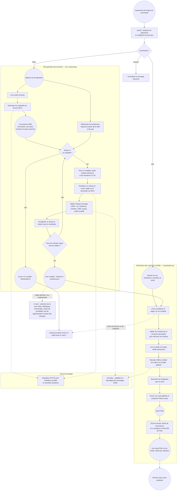

# Flux des données et commandes

Ce diagramme suit `src/ensemble_sensitivity/main.py` et les commandes
actuellement implémentées de récupération et de génération de cartes de
contrôle. Les rectangles représentent des opérations, les losanges des
conditions et les formes arrondies des entrées, des sorties ou des fichiers.

La commande `fetch` récupère les champs demandés et ne renvoie qu’un run pour
lequel tous les champs requis ont été validés. Elle réutilise les champs en
cache lorsqu’ils sont valides et conserve l’état du run dans son manifeste.
La commande `plot` lit ce manifeste et les champs sélectionnés pour produire
des cartes de contrôle individuelles ; elle ne calcule pas de carte de
sensibilité. En cas d’erreur pendant `fetch` ou `plot`, `main()` la journalise
et termine avec le code 1.

Les étapes statistiques décrites dans le README principal restent à
implémenter. Le diagramme ne les présente donc pas comme des fonctions déjà
disponibles.
